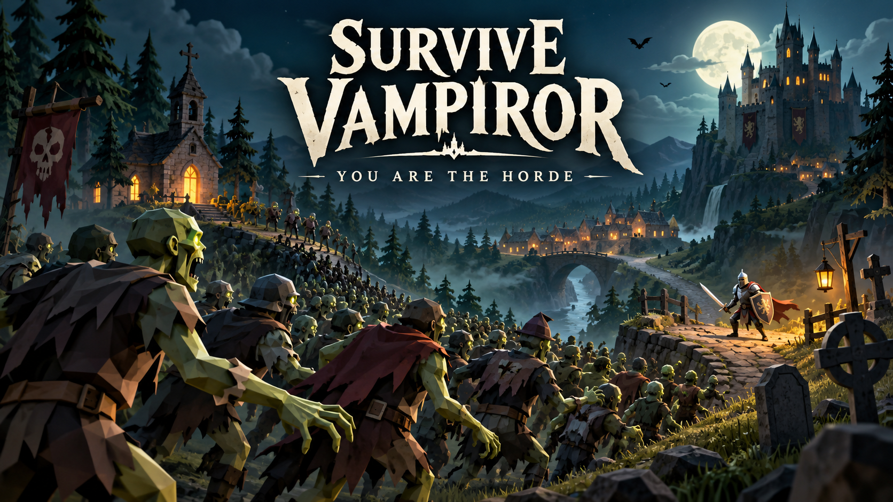
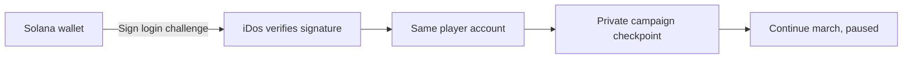

# Survive Vampiror

**You are the horde.** Lead forty zombies across a kingdom, outmaneuver its knights, and keep your permanent horde alive.



[Play on iDos](https://idosgames.com/app/FYVPZFCO/) · [Gameplay demo](https://youtu.be/GK23R-IHtwI) · [Founder pitch](https://youtu.be/xq_8Us-bS2A) · [Pitch PDF](output/pdf/survive-vampiror-pitch-solana.pdf) · [Colosseum project](https://colosseum.com/arena/projects/survive-vampiror)

## How the game plays

Command the whole horde with one destination. Surround the knight to bite automatically, then pull back when an attack is telegraphed. Losing permanent zombies weakens the army you take into the next battle; losing all of them ends the march.

- **Conquer five locations:** Village Graveyard → Village Chapel → Royal Road → Fortress Outskirts → Castle Courtyard. Each defender adds a signature attack, for ten attacks across the campaign.
- **Recruit and sacrifice:** hold a glowing crater to recruit temporary allies. Turn temporary recruits into passable corpse mines, launch one with the sling, or choose another build. Permanent zombies are never spent as mines.
- **Build between battles:** choose an offered upgrade or ten permanent zombies. Nine perks include three active abilities, sprint and five passive upgrades. Two ability slots make those choices matter.
- **Come back to your march:** private cloud checkpoints, paused Continue and Retry location preserve a campaign between sessions. Adventure is the starting difficulty; Relentless makes every knight hit lethal.

The game uses the original Survive Vampiror's models, animations and music, with procedural location scenery, readable ground warnings, drifting clouds, occasional rain and passing crows/bats. Sound, graphics, motion and keyboard bindings are adjustable.

| Action | Phone | Keyboard / mouse |
| --- | --- | --- |
| Lead the horde | Tap the ground | Click, WASD or arrow keys |
| Stop / cancel aim | Stop / Cancel | X or right-click |
| Unlocked abilities | Ability buttons | Q / E |
| Sprint, once unlocked | Sprint button | Space |
| Pause, route, perks, camera | Pause | Esc; mouse wheel also zooms |

## Best times

[Play the live version 13](https://idosgames.com/app/FYVPZFCO/). Production has ten independent boards; test-player scores remain in DEV.

Clear each location to post your fastest combat time. **Best times** opens from the main menu, Pause or the clear screen; choose a location and Adventure / Relentless to see the top 100 and your own rank. The five locations have independent, all-time boards for each difficulty. A slower attempt never replaces a faster one. Pauses, choosing upgrades and travel do not count; campaign perks carry over. Times display to the millisecond.

Continue preserves the current split, Retry location restores its entrance time, and unfinished locations are not submitted. Failed uploads stay in the cloud profile and can be retried. Older saves from later locations begin ranking at the next location because they have no recoverable split timer.

The iDos backend owns best-time aggregation and ranking; the browser reports the combat result. These are **casual, client-reported leaderboards**, not cheat-proof or prize-bearing results. No token or currency rewards are attached. Configuration and release state are recorded in [level leaderboard history](docs/feature-history/level-leaderboards.md).

## What Solana does for the player

**The same wallet recovers the same march on another browser.** Choose **Sign in with Solana** and sign the iDos login message. The server verifies the Ed25519 signature and returns a stable player account. That account owns the private checkpoint, settings and personal records used by the game.



No transaction or token purchase is needed to play or recover progress. Guest play is available, with separate saves: switching from guest to wallet does not transfer a guest march. Saves are off-chain iDos player data. Personal records are private, client-written data, not trusted competitive scores or on-chain achievements.

### Try the recovery flow

1. Sign in with Solana, start a march, move the horde, then pause. Wait for **Saved to your account**.
2. In another browser, open the **same environment** and sign in with the same wallet.
3. Select **Continue march**. The saved encounter opens paused, with its roster and progress intact. Use one active game session per account.

The menu's **Play across devices / Solana commander** disclosure explains this flow and shows the server-confirmed wallet identity. Authentication belongs to the iDos host; the game module does not create its own login session.

For reproducible verification without a funded wallet:

```sh
npm run verify:solana
```

This exercises real DEV authentication with disposable, unfunded keys: valid signature, server wallet identity, same-account recovery in a fresh client, actual campaign restoration, and rejection of an invalid signature. [Authentication code](src/base/login/SolanaLogin.tsx), [wallet adapter](src/base/login/solana-standard.ts), [verification script](scripts/verify-solana.mjs), and [integration decisions](docs/feature-history/solana-identity.md).

The separate [HORDE mainnet token](https://solscan.io/token/9UB6DJsQncQoxQrBW8a6HyyDAfeWKoYN7WaHmukpidos) is not required by gameplay. There are no implemented token rewards, trading mechanics or NFT items.

## Built with iDos Games

A native React / Three.js game module runs inside the iDos host, which provides sign-in, player state, private cloud data and hosting. Development uses iDos Code MCP skills and catalog modules; Data MCP configures the DEV backend and stages build artifacts. The title is `FYVPZFCO`, with isolated DEV title `FYVPZFCO-DEV`.

The [Superteam side track](https://superteam.fun/earn/listing/superteam-kazakhstan-x-idos-games-side-track/) includes wallet authentication among its Solana integration examples. This project ties that authentication to a concrete player benefit: recovering a campaign across browsers. The demo shows real gameplay; its captions explain the integration, while the recorded run uses a guest account.

## Local development

Use Node 22.12+; this workspace pins Node 24.15.0 in `.node-version`. The stack is React, strict TypeScript, Vite and Three.js 0.185.1, matching iDos's 3D module registry.

```sh
npm ci --ignore-scripts
cp .env.example .env.local
npm run dev
```

Open the local Vite URL printed by the command (normally `http://localhost:5180`). Local development uses `FYVPZFCO-DEV`; the canonical title identity remains `FYVPZFCO`. Wallet sign-in, guest access and title configuration come from the iDos backend.

```sh
npm run check
npm run mcp:check
```

## Verify the project

```sh
npm run typecheck       # strict TypeScript
npm test                # simulation, controls, persistence, presentation, wallet adapter
npm run build           # production bundle
npm run verify          # actual DEV login and private checkpoint round-trip
npm run verify:solana   # actual DEV signature login and cross-client recovery
npm run verify:leaderboards # actual DEV best-time aggregation and ranking
```

`npm run check` combines types, tests, build, DEV saves and the leaderboard check. Backend checks require network access. Tests include all five waves reached through ordinary movement and valid upgrades, recruitment, temporary-only passable mines, all ten knight attacks, deterministic checkpoint restore, save ordering/retries, paused input, camera projection and resource disposal. Browser inspection and physical touch playtesting remain separate checks.

## Source map

| Area | Location |
| --- | --- |
| Game loop, input, saves and Three.js rendering | [Horde game](src/modules/horde/game/) |
| Responsive HUD, menus and interactive field guide | [Horde components](src/modules/horde/components/) |
| Five locations and nine perks | [Campaign and perk data](src/modules/horde/data/) |
| Per-location best times | [Leaderboard screen](src/modules/leaderboard/) and [score outbox](src/modules/horde/game/leaderboard-sync.ts) |
| Host authentication | [Login](src/base/login/) and [wallet entry](src/walletLogin.tsx) |
| Automated verification | [Tests](tests/) and [scripts](scripts/) |
| Design constraints and implementation history | [Feature history](docs/feature-history/README.md) |

For agent and module conventions, read [IDOS.md](IDOS.md). For local MCP setup, source/hosting separation and the staging workflow, see [START_HERE.md](START_HERE.md) and [local development history](docs/feature-history/local-development.md).

## Release status

Published **2026-10-19**: [version 13 is live](https://idosgames.com/app/FYVPZFCO/) from source commit `904a3c0`. This release adds fastest-clear leaderboards for all five locations, separated by difficulty, with persistent best times and retryable uploads. Strict types, all 95 tests, packaging, real DEV checkpoint persistence, Solana identity recovery and leaderboard ranking checks passed. Phone and desktop layouts were checked locally. After enabling the ten matching PROD definitions, real SDK reads verified every board; the public iDos page loaded the new leaderboard, filters, fullscreen view and an existing paused checkpoint in Chrome. iDos MCP confirms this exact build as Live and Published. Physical touch-device and low-end performance checks remain outstanding. See [leaderboard release details](docs/feature-history/level-leaderboards.md).

`npm run package:dev` creates a local DEV archive. `npm run stage:dev` checks and uploads a candidate with `deploy=false`, returning a test URL. Publication is a separate, explicitly approved operation. See [release verification and device limits](docs/feature-history/release-readiness.md).

## Credits

Created by **meatPigeon**, using models, animations, music and other authored assets from the original Survive Vampiror Godot project. [Asset origin and conversion manifest](src/modules/horde/assets/reference/README.md). Development assisted by OpenAI Codex and iDos Code/Data MCP. Built with React, Three.js and the iDos SDK; typeset in Noto Sans and Noto Serif. The bundle includes dependency notices and the Noto font license.

Normal builds use committed runtime assets and do not need Godot. Re-exporting them with `npm run assets:port` requires the sibling Godot project and the version documented in the asset notes.
